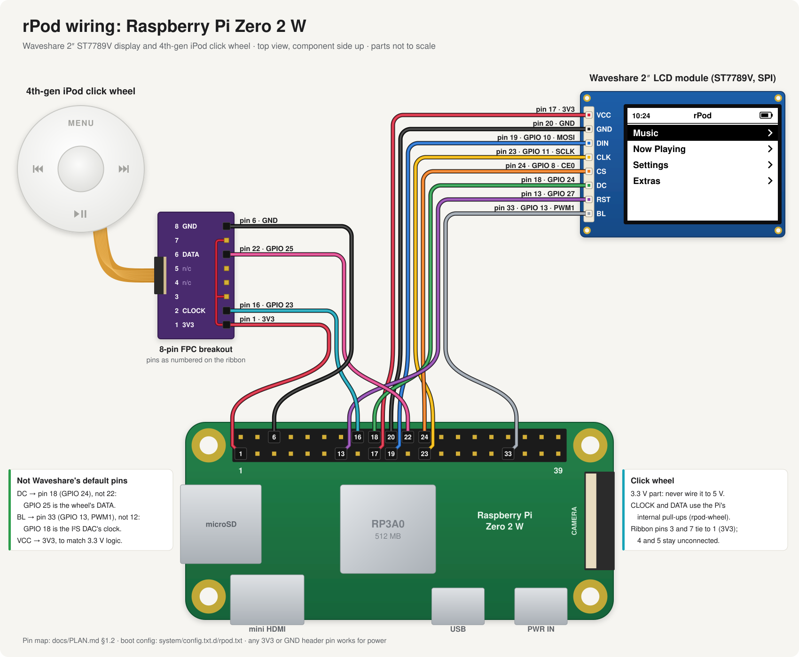

# rPod

A Raspberry Pi Zero 2 W music player built around an original 4th-gen iPod
click wheel and a 2" ST7789V LCD, playing lossless files via MPD over
Bluetooth.

Full spec, hardware BOM, GPIO map, and phased build plan: [`docs/PLAN.md`](docs/PLAN.md).

## Status

Hardware bring-up happens on a Raspberry Pi 3B breadboard dev board with the
real panel and click wheel wired to it, until everything moves into the
Zero 2 W build. Phases are in [`docs/PLAN.md`](docs/PLAN.md) §9.

- **Phase 0 (bring-up)**: done. `make build` cross-compiles on the PC
  against a sysroot copied off the Pi, and `make deploy-run` installs it.
- **Phase 1 (display)**: done and verified on hardware. The 2" ST7789V runs
  landscape 320×240 through fbtft, rotated in software so scrolling doesn't
  tear. LVGL animates at a measured 30 fps.
- **Phase 2 (click wheel)**: the bit map is derived on hardware
  ([`docs/clickwheel-protocol.md`](docs/clickwheel-protocol.md)), and the
  `rpod-wheel` daemon (`make deploy-wheel`) drives the UI on the Pi.
- **Phase 3 (audio)**: deferred. Audio is Bluetooth (Phase 6); the wired DAC
  may come later. Until then MPD plays through the 3B's headphone jack.
- **Phase 4 (UI)**: built and running on the Pi with the real wheel: the
  full §8.1 screen graph, scroll acceleration and alphabet scrub, Now
  Playing with cover art, a backlight timer and a sleep timer. The whole
  library (~830 tracks) is on the Pi. Settings → Theme switches between
  rPod's own Glass look and Classic / Classic Dark, the 4th-gen iPod's UI
  rebuilt from its firmware (§8.4). Extras has a clock with an alarm, Brick,
  Music Quiz and Screen Lock (§8.5). Still to do: the acceptance run, which
  means navigating to a song and playing it with only the wheel, and tuning
  scroll acceleration by feel. The desktop simulator (`make sim`) runs the
  same UI against a local MPD.
- **Phase 5 (power and USB)**: deferred. Music is uploaded through the web
  UI, so the USB gadget isn't needed; the battery work waits for later too.
- **Phase 6 (Bluetooth)**: running on the Pi. Settings → Bluetooth pairs
  and connects headphones over BlueZ, and MPD plays to them through a
  system-wide PipeWire. AirPods get their extras over Apple's accessory
  protocol: battery, noise control, their settings, ear detection and
  Conversation Awareness. Verified with AirPods Pro 2 so far: the
  accessory channel, ear detection, and that the adapter is bondable.
  Still to verify: that a fresh pairing bonds and reconnects when the case
  opens, stem presses, and swipe volume.
- **Phase 7 (hardening)**: not started.

The **web UI** (`http://rpod.local/`, [`docs/PLAN.md`](docs/PLAN.md) §8.6)
uploads music, manages the library and reaches the settings the wheel
can't: the click wheel's acceleration curve, live; ListenBrainz; MPD's
crossfade and Sound Check. It wears the device's theme, Glass or the
iPod's Classic, and follows it as it changes.

Haptics (Settings → Haptics) waits on the vibration motor being wired.

## Wiring

[](docs/wiring-zero2w.svg)

The display and the click wheel on the Pi Zero 2 W's header (click the
picture for full size). Pin-by-pin tables, and the rest of the header's
pins, are in [`docs/wiring.md`](docs/wiring.md).

## Building

```sh
# The iPod's own fonts and bitmaps for the Classic themes, from Apple's
# firmware (once per checkout; see below)
make ipod-assets

# Desktop UI simulator (no hardware needed)
make sim

# Cross-compile for the Pi (host needs clang + lld). `make sysroot` copies the
# Pi's headers/libraries into ./sysroot first -- once, and again after
# installing new -dev packages on the Pi.
make sysroot
make build

# Deploy + run on hardware (rpod.local)
make deploy-run

# The web UI: on the Pi (then http://rpod.local/), or on the dev machine
# against the sim's MPD and the sim (then http://localhost:8080/)
make deploy-web
make web-sim
```

Uploads need the music directory writable by the `rpod` user
(`make deploy-web` says if it isn't). To ask for a password, put
`RPOD_WEB_PASSWORD=...` in `/etc/rpod/env`.

The Classic themes draw with the iPod's own fonts and bitmaps. They're
Apple's, so they aren't in the repository: `make ipod-assets`, once per
checkout, downloads the iPod 4G's firmware from Apple and extracts them into
`re/ipod4/out/` with `re/ipod4/tools/extract.py` (python3 only). Without
them, Classic keeps its layout but falls back to Montserrat, and the build
says so.

## Layout

- `src/` — on-device application (UI, input, MPD client, Bluetooth).
- `daemon/` — `rpod-wheel`, the privileged click wheel decoder, and the
  `wheel_protocol.h`/`wheel_bits.h` headers shared with its clients.
- `web/` — `rpod-web`, the web UI's daemon, and the page it serves
  (`web/static/`).
- `system/` — boot config fragments, systemd units, udev rules, USB gadget setup.
- `tools/` — `wheel-sniff` (protocol analysis), `wheel-test-client` (prints
  normalised wheel events), `fb-test` (raw framebuffer colour/orientation
  check), `fake-airpods.py` (AirPods stand-in for the sim), and `sim/`
  (desktop UI harness).
- `tests/` — host-run unit tests (`make test`).
- `third_party/` — vendored LVGL.

## License

Copyright © 2026 Massimo Faulkner. rPod's code, docs and configuration are
licensed under [Creative Commons Attribution-NonCommercial 4.0
International](https://creativecommons.org/licenses/by-nc/4.0/) (CC BY-NC
4.0) — full text in [`LICENSE`](LICENSE).

You're free to use, copy, modify and share it, as long as:

- **you credit it** — name the author, link to this project and the
  license, and say if you changed anything. For example: "Based on rPod by
  Massimo Faulkner, licensed under CC BY-NC 4.0."
- **you don't use it commercially** — no selling it, or kits, boards or
  products built from it, without asking first.

Third-party parts keep their own licenses: LVGL (`third_party/lvgl`) is MIT,
and the Montserrat fonts in `src/ui/fonts/` and `web/static/fonts/` are SIL
OFL 1.1 (`web/static/fonts/Montserrat-OFL.txt`). The AirPods
pictures in `src/ui/airpods_art_data.c` come from Wikimedia Commons — the
buds from a photo by Burkhard Mücke (CC BY-SA 4.0, which that image keeps),
the case from one by Jackienyyy (CC0) — and the AirPods glyph is
MingCute's (Apache-2.0); see `tools/airpods-art.py`. Click wheel
decoding derives from `dupontgu/retro-ipod-spotify-client` (Apache-2.0) —
see `docs/PLAN.md` §12. AirPods support is reimplemented from the protocol
notes in LibrePods (`kavishdevar/librepods`, GPL-3.0); none of its code is
included.
